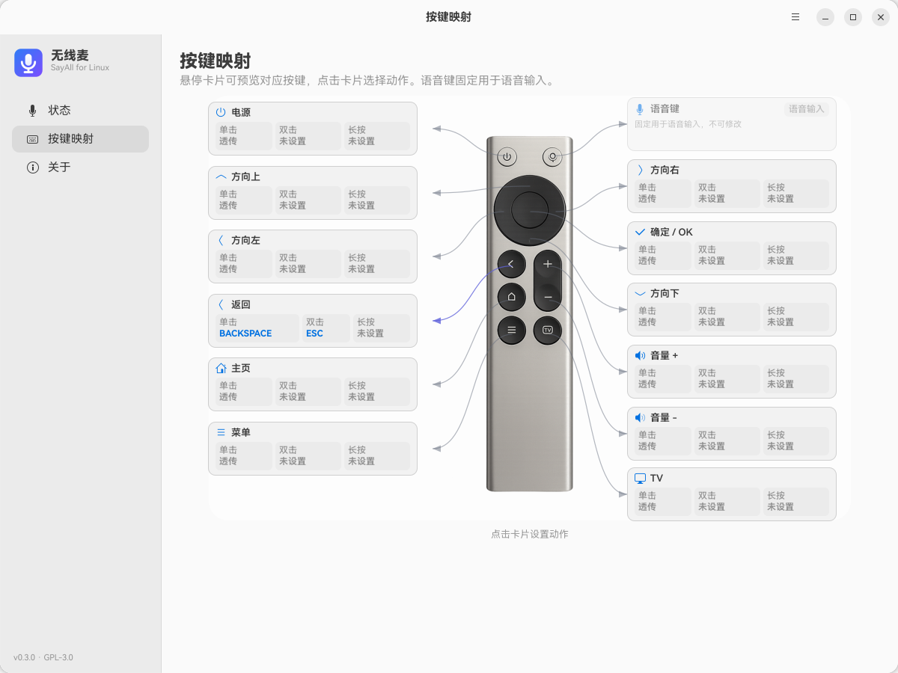

# 无线麦 · SayAll for Linux

把 **小米蓝牙遥控器 2 / 2 Pro** 变成 Linux 桌面上的无线麦克风和语音输入快捷键。

按住遥控器语音键说话，松开即完成识别并把文字送进当前输入框。支持 PipeWire 虚拟麦克风、Vokie 语音输入、按键映射和 GTK4 图形界面。

> 本项目是独立的 Linux 实现，参考了 [HD838A/remote-mic-app](https://github.com/HD838A/remote-mic-app)（macOS）与 [GetSayAll/remote-mic-app-windows](https://github.com/GetSayAll/remote-mic-app-windows)（Rust 核心）公开的 ATVV 协议资料，代码为原创。与上述项目作者无隶属关系。




## 功能

- **BLE / ATVV 直连**：不需要驱动、不需要改内核，BlueZ 即可
- **遥控器麦克风 → PipeWire 虚拟麦克风**：`sayall-mic`，16 kHz 单声道
- **语音键拦截**：遥控器语音键（F5）被桥接吞掉，不会再刷新网页
- **语音引擎可切换**
  - **Vokie**：注入 Vokie 的「按住说话」热键（支持组合键，含 Ctrl+Win 这类纯修饰键）
  - **自定义命令**：按下/松开时执行任意命令
- **按键映射**：每个按键支持单击 / 双击 / 长按；动作可选透传 / 禁用 / 启动应用 / 执行命令 / 发送按键组合
- **图形界面**：GTK4 + libadwaita，状态、电平、增益、按键映射
- **首次使用引导**：内置检查清单，引导安装 Vokie、配对遥控器、启动桥接、设置触发键
- **自动恢复**：遥控器重连后自动重新抓取；开麦会话 60 秒超时自动续开

## 架构

```
遥控器 (BLE)
   │  ATVV GATT: AB5E0001-… (Audio/Control/Transmit)
   ▼
sayall-bridge (Python)
   ├─ IMA/DVI ADPCM 解码 → 16 kHz PCM
   │      └→ pw-cat → PipeWire 虚拟麦克风 sayall-mic
   ├─ HID 语音键 (F5) 抓取 / 吞掉 / 其余按键转发
   └─ 触发语音引擎（注入 Vokie 热键 / 执行自定义命令）
   ▼
Vokie / 其他语音输入软件 → 识别 → 粘贴到当前输入框
```

## 环境要求

- Linux + PipeWire（已在 Ubuntu 26.04 / GNOME 50 / Wayland 上验证）
- BlueZ（`bluetoothctl`）、PipeWire（`pw-loopback`、`pw-cat`、`pw-dump`）、WirePlumber（`wpctl`）
- Python 3.10+
- `python3-gi`、`python3-gi-cairo`、`python3-bleak`、`python3-evdev`
- 图形界面需要 GTK4 + libadwaita（`gir1.2-gtk-4.0`、`gir1.2-adw-1`）
- 语音软件：推荐 [Vokie](https://vokie.com/)（Linux 版）

## 安装

整个过程只需要三步：**装 Vokie（可选）→ 配对遥控器 → 装本项目的 .deb**。首次打开应用会弹出一个引导窗口，逐项检查并给出按钮。

### 1. 安装 Vokie（语音引擎，推荐）

1. 打开 [vokie.com/download.html](https://vokie.com/download.html)，下载 Linux 版并安装
2. 安装后启动一次 Vokie，确认它能正常识别语音
3. 记下它的「按住说话」快捷键（默认 `Ctrl+Win`，也可以稍后在「无线麦」里修改）

> 不想用 Vokie 也可以：在应用里把语音引擎切换成「自定义命令」，按下/松开时执行任意命令。

### 2. 配对遥控器

1. 同时长按遥控器的「主页 + 菜单」键，直到指示灯闪烁
2. 在系统蓝牙设置里连接 `MI RC` / `小米蓝牙语音遥控器`

命令行配对（自动确认配对请求）：

```bash
bluetoothctl
[bluetooth]# agent on
[bluetooth]# default-agent
[bluetooth]# pair AA:BB:CC:DD:EE:FF
```

### 3. 安装本项目

**方式 A：从 Release 安装 .deb（推荐）**

```bash
# 从 https://github.com/ZXC011/sayall-linux/releases 下载
sudo apt install ./sayall-linux_0.3.0_all.deb
systemctl --user enable --now sayall-bridge.service
```

`apt` 会自动安装包里的依赖，不需要手动装。**不要用 `dpkg -i`**（它不解析依赖）。

**方式 B：源码安装**

```bash
git clone https://github.com/ZXC011/sayall-linux.git
# 国内网络可改用 SSH over 443：
# git clone ssh://git@ssh.github.com:443/ZXC011/sayall-linux.git
cd sayall-linux
./install.sh
systemctl --user enable --now sayall-bridge.service
```

### 4. 打开界面，跟着引导走

应用列表里会出现 **无线麦**，或直接运行：

```bash
sayall-gui
```

首次启动会弹出「开始使用」引导，四步逐项检查：


| 步骤 | 引导里的按钮 |
|---|---|
| 安装 Vokie | 未安装 → 打开下载页；已安装 → 直接启动 |
| 配对遥控器 | 打开系统蓝牙设置（已配对时显示「已配对」） |
| 启动桥接服务 | 一键启动（运行中时显示「运行中」） |
| 设置触发快捷键 | 录制 Vokie 的按住说话键 |

引导可以随时从右上角 **☰ → 使用引导** 重新打开。全部显示绿点后，按住遥控器语音键说话即可。

### 5. 检查 Vokie 热键（可选）

- 在界面「语音输入 → 触发快捷键」里录制 Vokie 的按住说话键（例如 `F9` 或 `Ctrl+Win`）
- 也可以直接使用 Vokie 的默认热键；桥接会自动读取 `~/.config/vokie/app-settings.json`

## 使用

- **遥控器语音键**：按住说话，松开结束
- **界面**
  - 状态页：连接状态、电量、麦克风电平、输入增益、触发快捷键
  - 按键页：13 个遥控器按键的单击 / 双击 / 长按动作（语音键固定不可改）
  - 关于页：配置与状态文件位置
- **右上角 ☰**：重新打开「使用引导」、完全退出（停止桥接并关闭 Vokie）

## 配置

配置文件：`~/.config/sayall-linux/config.json`（桥接会在 1 秒内热加载）

| 字段 | 说明 |
|---|---|
| `address` | 遥控器蓝牙地址 |
| `gain_db` | 输入增益（0–24 dB，默认 6） |
| `preopen_mic` | 保持开麦，60 秒超时自动续开 |
| `voice_engine` | `vokie` 或 `custom` |
| `voice_start_command` / `voice_stop_command` | 自定义引擎命令 |
| `button_map` | `{"键码": "动作"}`，动作见下 |
| `known_keys` | 兼容旧配置的额外按键（一般不用改） |

动作格式：

- `passthrough`（默认，透传）
- `disabled`（吞掉）
- `app:<desktop-id>`（如 `app:firefox.desktop`）
- `command:<shell 命令>`
- `key:<按键组合>`（如 `key:CTRL+ENTER`）

状态文件：`~/.cache/sayall-linux/status.json`

调试模式（会把最近一次音频写到 `/tmp/sayall-last.wav`，仅在排查时使用）：

```bash
SAYALL_DEBUG=1 systemctl --user restart sayall-bridge
```

## 已知限制

- **Vokie 在 GNOME Wayland 下的粘贴问题**：Vokie 通过 `xprop` 判断焦点窗口，GNOME 下拿不到 `WM_CLASS`，会误判为终端并发送 `Ctrl+Shift+V`，导致部分应用（如微信 4.x）不自动粘贴。这是 Vokie 上游的行为，本项目未做侵入式修改。
- **Vokie 的 Linux 版不支持原生小米遥控器**：缺少 `xiaomi-remote-helper`，所以需要本项目做桥接。
- 只在 **RC003（2 Pro）** 上验证；RC001（遥控器 2）理论上兼容但未实测。
- 遥控器语音键的实际键码是 **F5（63）**；桥接会吞掉它，桥接未运行时 F5 会落到前台应用（浏览器刷新）。
- 需要在 **当前图形会话** 中运行（`/dev/uinput`、PipeWire、XWayland 环境）。

## 协议与致谢

- ATVV 协议细节见 [docs/PROTOCOL.md](docs/PROTOCOL.md)
- 常见问题见 [docs/TROUBLESHOOTING.md](docs/TROUBLESHOOTING.md)
- 参考项目：
  - [HD838A/remote-mic-app](https://github.com/HD838A/remote-mic-app)（macOS 版，GPL-3.0）
  - [GetSayAll/remote-mic-app-windows](https://github.com/GetSayAll/remote-mic-app-windows)（Rust 核心，GPL-3.0）
- **素材与界面**：遥控器实拍图 `assets/remote-rc003.png` 与按键映射页布局来自 [GetSayAll/remote-mic-app-windows](https://github.com/GetSayAll/remote-mic-app-windows)（GPL-3.0），本项目按其 Vue / CSS 参数用 GTK4 重新实现

## 许可证

[GPL-3.0-only](LICENSE)

---

## English

**SayAll for Linux** turns a Xiaomi Bluetooth Remote 2 / 2 Pro into a wireless
microphone and push-to-talk key for Linux. It connects over BLE using the ATVV
protocol, decodes the remote's ADPCM audio into a PipeWire virtual microphone,
swallows the remote's F5 voice key, and triggers a dictation app (Vokie by
default) by injecting its push-to-talk hotkey. A GTK4 GUI provides status,
gain control, per-button mappings and a first-run guide for installing Vokie
and pairing the remote.

Licensed under GPL-3.0-only.
